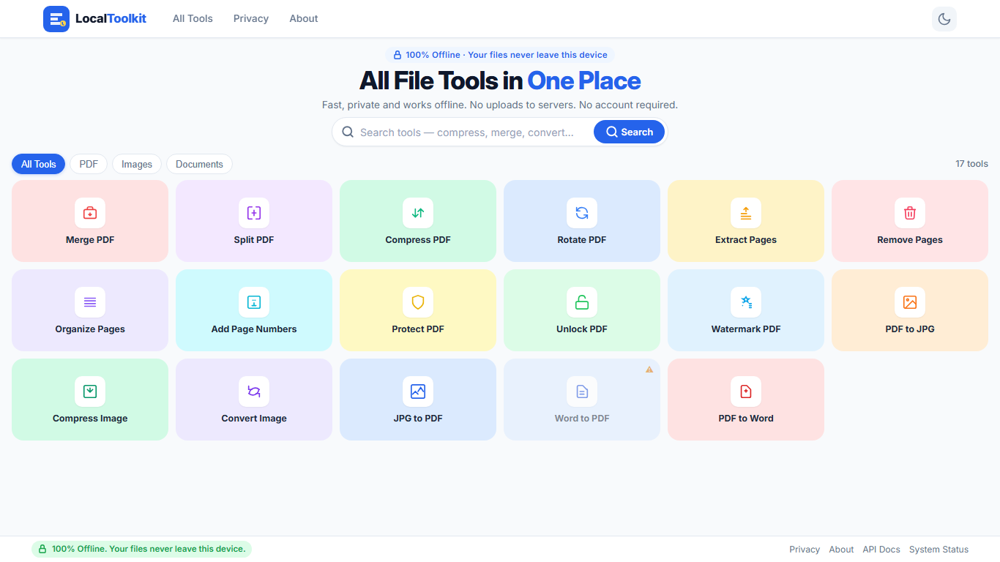
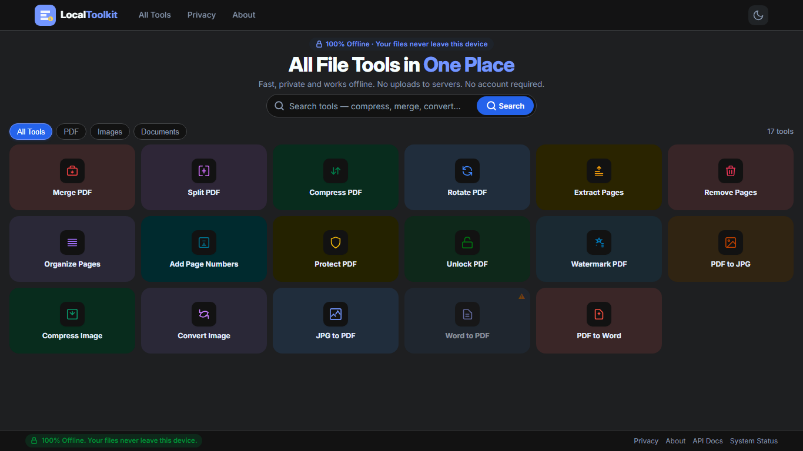
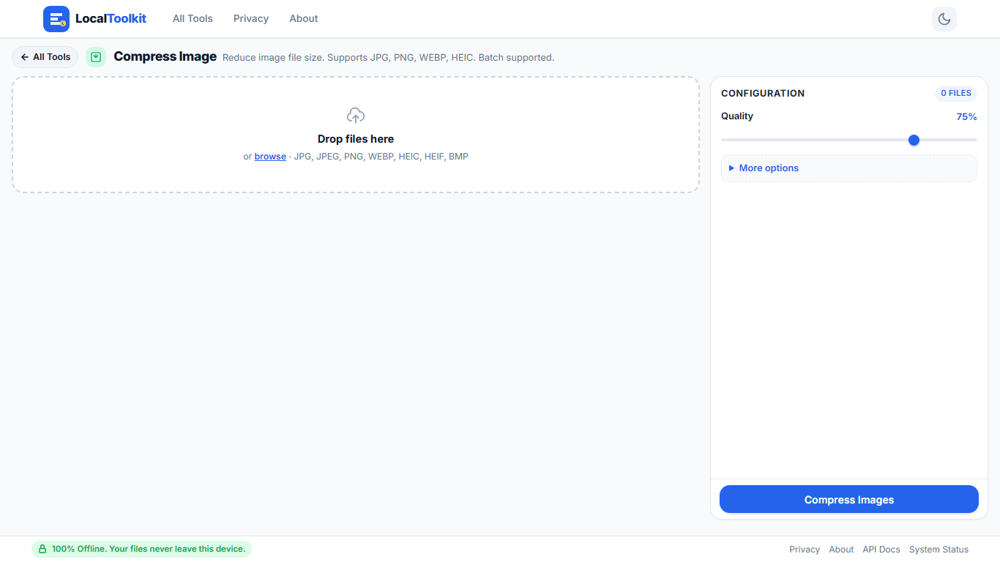

# LocalToolkit 🛠️

[](https://github.com/Sidhartha-roy104/LocalToolKit)
[](https://opensource.org/licenses/MIT)
[](https://www.python.org/)

**A beautiful, simple, 100% offline all-in-one file tools app running locally on your computer.**

Files **NEVER** leave your machine. No telemetry, no remote uploads, no account required, and zero cloud dependencies. It binds strictly to `127.0.0.1` and operates with full fidelity offline.

---

## 📸 Screenshots

### Light Mode & Dark Mode
| Light Mode (Clean pastel interface) | Dark Mode (Full dark theme) |
| :---: | :---: |
|  |  |

### Minimal-Scroll Workspace
| Two-Column Tool Workspace | Batch Processing & Reordering |
| :---: | :---: |
|  |  |

---

## ⚡ Run in 3 Steps (Quick Start)

### Windows
1. Ensure [Python 3.11+](https://www.python.org/downloads/) is installed (check *"Add Python to PATH"* during install).
2. Double-click **`setup_and_run.bat`** (or run `.\setup_and_run.bat` from terminal).
3. The script automatically creates an isolated virtual environment, installs the lightweight dependencies, and launches your browser to `http://127.0.0.1:8787/`.

### macOS / Linux
1. Ensure Python 3.11+ is installed.
2. In terminal, run:
   ```bash
   chmod +x setup_and_run.sh
   ./setup_and_run.sh
   ```
3. Your default browser opens automatically to the LocalToolkit workspace.

---

## 🚀 Download Ready-Made Windows .exe

No Python installed? You can download the pre-packaged standalone Windows application directly from GitHub Releases:

👉 **[Download Latest LocalToolkit.exe (GitHub Releases)](https://github.com/Sidhartha-roy104/LocalToolKit/releases)**

1. Download `LocalToolkit.zip` from the latest release.
2. Extract the folder to any location on your PC.
3. Double-click **`LocalToolkit.exe`** to start.

> **🛡️ Note on Windows SmartScreen:**  
> Because this is a newly built, community open-source executable without an expensive commercial code-signing certificate, Windows Defender SmartScreen may display an alert on first launch (*"Windows protected your PC"*).  
> Click **"More info"** and then select **"Run anyway"**. LocalToolkit contains zero network access code, binds exclusively to loopback `127.0.0.1`, and processes all files in local temporary memory.

---

## 🧰 All Tools Included (17 Tools)

### 📄 PDF Tools
- **Merge PDF:** Combine multiple PDF documents in custom drag-and-drop order.
- **Split PDF:** Extract custom page ranges (`1-3, 5, 7-10`) or split all pages into separate PDFs.
- **Compress PDF:** Downsample raster images and compress streams (Low, Medium, High).
- **Rotate PDF:** Rotate all or specific pages clockwise by 90°, 180°, or 270°.
- **Extract Pages:** Pull specific pages out into a fresh document.
- **Remove Pages:** Delete unwanted pages from a PDF.
- **Organize Pages:** Reorder and arrange pages with an intuitive sequence.
- **Add Page Numbers:** Stamp page numbers onto headers or footers with customizable position, format, and font size.
- **Protect PDF:** Encrypt a PDF with password protection (AES-128).
- **Unlock PDF:** Remove password restriction from password-protected PDFs.
- **Watermark PDF:** Add angled, semi-transparent text watermarks across document pages.
- **PDF to JPG / PNG:** Render PDF pages into crisp high-resolution images bundled in a ZIP.

### 🖼️ Image Tools
- **Compress Image:** Optimize JPG, PNG, WEBP, HEIC, and BMP images with quality and resolution limits. Supports multi-file batches.
- **Convert Image:** Convert images across JPG, PNG, WEBP, and BMP formats.
- **JPG to PDF:** Convert image collections into a unified multi-page PDF document.

### 📝 Document Tools
- **Word to PDF:** Convert `.docx`, `.doc`, `.odt`, or `.rtf` documents using headless LibreOffice.
- **PDF to Word:** Convert PDFs into editable `.docx` files using `pdf2docx`.

---

## 🔌 Optional External Dependencies

LocalToolkit runs 100% standalone for all core PDF and Image tools. Advanced document conversions leverage standard local tools if installed:

| Tool / Feature | External Utility | Status | Download Link |
| :--- | :--- | :--- | :--- |
| **Word to PDF** (`.docx` / `.doc` / `.odt` → `.pdf`) | **LibreOffice** (`soffice`) | *Optional* | [Download LibreOffice](https://www.libreoffice.org/download/libreoffice-fresh/) |
| **PDF PostScript processing** | **Ghostscript** (`gs`) | *Optional* | [Download Ghostscript](https://www.ghostscript.com/releases/index.html) |
| **OCR Image to Text** | **Tesseract OCR** (`tesseract`) | *Optional* | [Download Tesseract](https://github.com/UB-Mannheim/tesseract/wiki) |

> If an optional dependency is not found, LocalToolkit will **never crash** — it displays a friendly in-app status card with direct download guidance.

---

## 🔒 Security & Privacy Guarantees

1. **Loopback Only:** Strict binding to `127.0.0.1` prevents remote access over local Wi-Fi or LAN.
2. **Zero Remote Requests:** No CDNs, no Google Fonts, no external JavaScript dependencies, and no remote telemetry.
3. **Strict Validation:** File sizes, extensions, and magic-byte headers are verified before processing.
4. **Path-Traversal Guard:** Strict output validation ensures files are confined to designated session directories.
5. **Auto-Cleaning Temp Storage:** Work files are written to unique UUID subdirectories in the operating system's temporary directory (`%TEMP%/localtoolkit`) and cleaned up immediately after each request.

---

## 🛠️ Developer & Manual Setup

### Clone and Install
```bash
git clone https://github.com/Sidhartha-roy104/LocalToolKit.git
cd LocalToolKit
python -m venv venv

# Windows
venv\Scripts\activate
# macOS/Linux
source venv/bin/activate

pip install -r requirements.txt
```

### Run Locally
```bash
python run.py
```

### Packaging Windows Standalone .exe
```cmd
build.bat
```
The output will be placed in `dist/LocalToolkit/LocalToolkit.exe`.

### Running Tests
```bash
python -m pytest tests/ -v
```

---

## 📜 License

Distributed under the [MIT License](LICENSE). Copyright &copy; 2026 Sidhartha-roy104.
